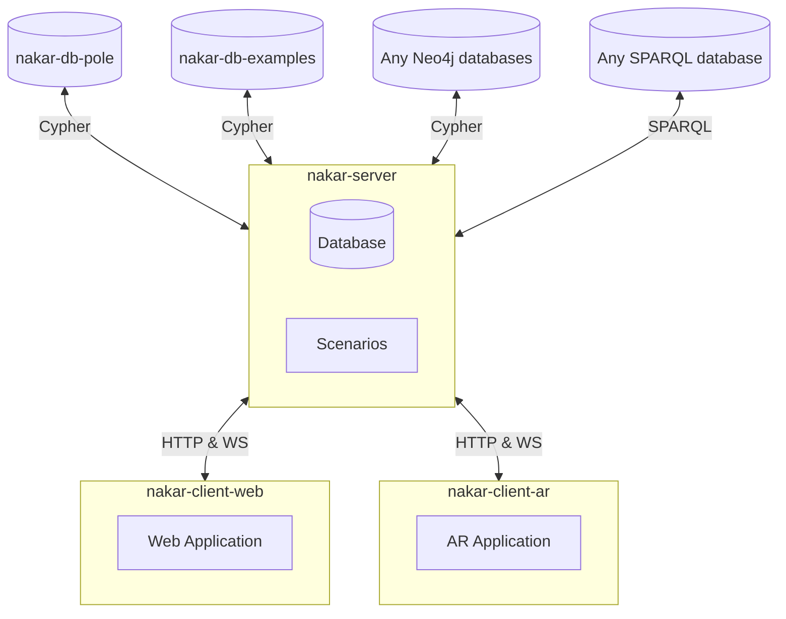

<h1>NAKAR</h1>

NAKAR is a collaborative application for exploring graph data in real time.

See https://go.thm.de/nakar.

## Local setup

1. Start the POLE database ([nakar-db-pole](./nakar-db-pole/README.md))
1. Start the Examples database ([nakar-db-examples](./nakar-db-examples/README.md))
1. Start the server ([nakar-server](./nakar-server/README.md))
1. Start the web application ([nakar-client-web](./nakar-client-web/README.md))

## Architecture

