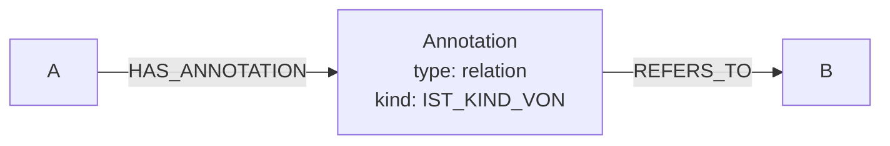
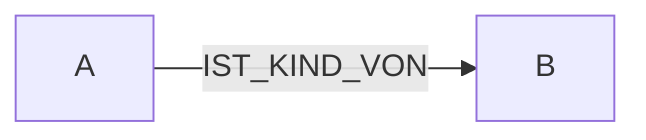

# Context

[RAMEN](https://ramen-schema.org/) is a model for digital scholarly editions. An object can be linked to an `Annotation` node through `HAS_ANNOTATION`. The annotation can refer to another object through `REFERS_TO`. In the canvas, NAKAR can represent this path as a single directed edge. The database connection configuration determines which annotation types are eligible and which property supplies the edge title.
## Acceptance criteria

- [ ] An Owner or Collaborator can select a configured RAMEN database connection for a scenario graph query.
- [ ] An Owner or Collaborator can configure an edge-title rule on the database connection. Each rule maps an exact annotation `type` value to the annotation property used as the edge title. A rule applies only to its configured type.
- [ ] NAKAR evaluates each `Annotation` node in the result of each RAMEN graph query before adding the result to the canvas. The annotation qualifies when all of the following conditions are met:
    - The result contains exactly one incoming `HAS_ANNOTATION` relationship from a source node and exactly one outgoing `REFERS_TO` relationship to a target node.
    - The source, annotation and target all originate from the database connection that defines the rule.
    - The annotation's `type` matches a configured rule and the selected property contains a non-blank string.
- [ ] For each qualifying annotation, the canvas adds one directed edge from the source to the target, uses the configured property value as its title, and removes the annotation node and all its incident edges. Other nodes connected to the annotation remain visible. If an annotation is itself an endpoint of a qualifying path, it remains visible as a node.
- [ ] Annotations that do not qualify remain visible. Their returned relationships to other visible nodes remain visible too. This includes annotations with no matching rule, a missing or empty title value, a missing source or target, multiple source or target relationships, or a path that spans database connections.

# Example

The database connection maps `type = "relation"` to the `kind` property for the edge title.

If the annotation meets the criteria above, the canvas displays:

